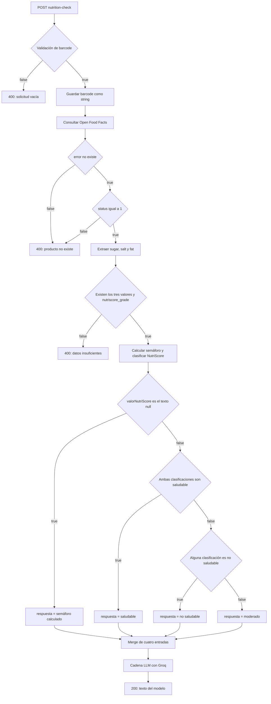

# SnackCheck · Semáforo nutricional con n8n

SnackCheck es un flujo de n8n que recibe un código de barras mediante un webhook, consulta Open Food Facts y obtiene una clasificación a partir de tres nutrientes por 100 g y del NutriScore disponible. Después, utiliza Groq con el modelo `openai/gpt-oss-20b` para redactar una recomendación breve en español.

La clasificación se calcula mediante código y condiciones de n8n. El modelo recibe únicamente el resultado de esa clasificación para redactar el mensaje final.

> **Alcance de esta documentación:** revisión estática de la exportación JSON `SnackCheck`, recibida como `Texto pegado.txt`. Describe los nodos y conexiones existentes, incluidos sus límites e inconsistencias. No acredita ejecuciones correctas, pruebas de integración ni un despliegue operativo.

## Contenido

- [API de entrada y ejemplo de uso](#api-de-entrada-y-ejemplo-de-uso)
- [Recorrido del flujo](#recorrido-del-flujo)
- [Consulta a Open Food Facts](#consulta-a-open-food-facts)
- [Validación de datos](#validación-de-datos)
- [Reglas de clasificación](#reglas-de-clasificación)
- [Generación del mensaje con Groq](#generación-del-mensaje-con-groq)
- [Respuestas HTTP y errores](#respuestas-http-y-errores)
- [Importación y configuración](#importación-y-configuración)
- [Estructura del repositorio](#estructura-del-repositorio)
- [Estado de las pruebas](#estado-de-las-pruebas)
- [Limitaciones y mejoras pendientes](#limitaciones-y-mejoras-pendientes)

## API de entrada y ejemplo de uso

| Propiedad | Configuración exportada |
| --- | --- |
| Método | `POST` |
| Path del nodo Webhook | `nutrition-check` |
| Cuerpo utilizado | JSON con el campo `barcode` |
| Expresión de lectura | `$json.body.barcode` |
| Tipo esperado por la condición inicial | Número, con validación estricta |
| Modo de respuesta | `responseNode`: responde un nodo Respond to Webhook |
| Autenticación del webhook | No se configura autenticación en la exportación |

En una instalación con las rutas habituales de n8n:

```text
Pruebas:    POST https://TU-N8N/webhook-test/nutrition-check
Producción: POST https://TU-N8N/webhook/nutrition-check
```

Usa la URL exacta que muestre tu nodo Webhook: el dominio, el prefijo y la configuración del despliegue pueden variar. La URL de pruebas requiere poner el webhook a la escucha; la de producción requiere publicar o activar el flujo. [Documentación del Webhook de n8n](https://docs.n8n.io/integrations/builtin/core-nodes/n8n-nodes-base.webhook/).

### Body

Para ajustarse al validador actual, envía `barcode` como número JSON:

```json
{
  "barcode": 8480000505460
}
```

No envíes un objeto adicional llamado `body`: n8n crea ese envoltorio al recibir la petición. No se leen el código desde parámetros de consulta, desde la ruta ni desde un lote de productos.

### Ejemplo curl

Ejemplo para Bash, con el webhook de pruebas escuchando:

```bash
curl --include --request POST \
  'https://TU-N8N/webhook-test/nutrition-check' \
  --header 'Content-Type: application/json' \
  --data '{"barcode":8480000505460}'
```

En PowerShell, se puede evitar el escape de comillas pasando un archivo. Guarda el body anterior como `request.json` y ejecuta:

```powershell
curl.exe --include --request POST "https://TU-N8N/webhook-test/nutrition-check" --header "Content-Type: application/json" --data-binary "@request.json"
```

Sustituye la URL por la de tu instancia. El código de barras procede del ejemplo incluido en el flujo; no se ha verificado que el producto exista ni que tenga datos suficientes. Estos comandos son instrucciones de uso, no pruebas ejecutadas.

## Recorrido del flujo

La exportación contiene **26 nodos**, `executionOrder: "v1"`, `active: true` y `pinData: {}`. El indicador `active` describe el archivo exportado y no confirma que el flujo esté publicado en otra instancia.

El siguiente diagrama resume las conexiones. Las salidas de error de los IF representan una condición evaluada como falsa; una excepción de ejecución puede detener el recorrido antes de alcanzar esas salidas.



### Inventario de nodos

Se conservan los nombres del JSON, incluidas sus erratas, para facilitar la búsqueda en el editor.

| N.º | Nodo | Función y conexiones |
| --- | --- | --- |
| 1 | `Webhook` | Recibe el POST y pasa al validador inicial. |
| 2 | `Validar - Barcode existe y es un número` | IF `number / exists` sobre `body.barcode`; true → guardar variable; false → solicitud vacía. |
| 3 | `Guardar variable - Guardamos la variable barcode` | Crea `barcode` como string y conserva los demás campos. |
| 4 | `API - Consultamos información de barcode` | Consulta Open Food Facts; configura `onError: continueRegularOutput`. |
| 5 | `Validar - Barcode existe en la BBDD` | IF `object / notExists` sobre `$json.error`; true → comprobar status; false → producto inexistente. |
| 6 | `Comprobar - API devuelve datos válidos` | IF numérico `status == 1`; true → extraer nutrientes; false → producto inexistente. |
| 7 | `Obtener - Valores nutricionales` | Crea `sugar`, `salt` y `fat` como números y conserva el resto de la respuesta de la API. |
| 8 | `Comprobar - Existen todos los valores necesarios para comprobación` | AND de cuatro comprobaciones de existencia: tres nutrientes y `product.nutriscore_grade`. |
| 9 | `Calcular - Semáforo saludable` | Valida valores y calcula `puntuacion`, `clasificacion` y `semaforo`. |
| 10 | `Obtener - Dato del semáforo saludable` | Copia `clasificacion` en `semaforoSaludable`, conservando los campos anteriores. |
| 11 | `Calcular - Valor nutriScore` | Recupera el grado desde el nodo 7, lo normaliza y crea `clasificacionNutriScore`. |
| 12 | `Obtener - Dato NutriScore` | Copia esa clasificación en `valorNutriScore`, conservando los demás campos. |
| 13 | `Comprobar - ¿Tenemos dato de NutriScore?` | Comprueba igualdad con el string `"null"`; true → usar solo el semáforo; false → combinar clasificaciones. |
| 14 | `Establecer - Semáforo Saludable como respuesta` | Deja `respuesta = semaforoSaludable`; conecta con la entrada 0 del Merge. |
| 15 | `Comprobar - ¿Ambos datos son "saludable"?` | AND: ambas clasificaciones deben ser `saludable`. |
| 16 | `Establer - Saludable` | Deja `respuesta = "saludable"`; conecta con la entrada 1 del Merge. |
| 17 | `Comprobar - ¿Ambos datos son NO saludable?` | Usa OR: basta con una clasificación `no saludable`. |
| 18 | `Establecer - No saludable` | Deja `respuesta = "no saludable"`; conecta con la entrada 2 del Merge. |
| 19 | `Establecer - Moderado` | Deja `respuesta = "moderado"`; conecta con la entrada 3 del Merge. |
| 20 | `Obtener - Respuesta` | Merge con `numberInputs: 4`; reúne las ramas antes de la cadena LLM. |
| 21 | `Groq Chat Model` | Modelo `openai/gpt-oss-20b`; conexión `ai_languageModel` con el nodo 22. |
| 22 | `AI - Health Verfict` | Cadena LLM con prompt definido y clasificación interpolada desde `$json.respuesta`. |
| 23 | `Responder - Respuesta final` | HTTP 200; cuerpo `$json.text`; modo Text. |
| 24 | `Responder - Solicitud vacía` | HTTP 400; JSON con código `BARCODE_NO_EXIST`. |
| 25 | `Responder - Código de barras no existe` | HTTP 400; mensaje fijo en modo Text. |
| 26 | `Respuesta - Datos insuficientes` | HTTP 400; mensaje fijo en modo Text. |

Los índices del Merge son los del JSON, empezando en cero. Sus parámetros no especifican `mode`; el valor predeterminado del nodo Merge v3 es `append`. El Merge no calcula una media ni decide la clasificación: recibe los resultados de las ramas. [Definición del modo predeterminado en n8n](https://github.com/n8n-io/n8n/blob/master/packages/nodes-base/nodes/Merge/v3/actions/mode/index.ts).

## Consulta a Open Food Facts

El nodo HTTP Request utiliza esta URL, con método GET predeterminado:

```text
https://world.openfoodfacts.org/api/v2/product/{barcode}.json?fields=product_name,brands,nutriscore_grade,nutriments
```

La expresión exacta de la exportación es:

```text
=https://world.openfoodfacts.org/api/v2/product/{{$json.barcode}}.json?fields=product_name,brands,nutriscore_grade,nutriments
```

| Campo consultado | Uso real |
| --- | --- |
| `product_name` | Se solicita, pero no se incorpora al prompt ni a la respuesta final mediante una expresión. |
| `brands` | Se solicita, pero no interviene en la clasificación ni en el prompt. |
| `nutriscore_grade` | Se transforma en una de las tres clasificaciones o en el string `"null"`. |
| `nutriments.sugars_100g` | Se asigna a `sugar`. |
| `nutriments.salt_100g` | Se asigna a `salt`. |
| `nutriments.fat_100g` | Se asigna a `fat`. |
| `status` de la respuesta | Debe ser el número `1` para continuar. |

No hay credenciales, cabeceras personalizadas, caché, reintentos explícitos ni timeout específico configurados en ese nodo. Sus opciones están vacías; siguen aplicándose los comportamientos predeterminados de n8n y de la infraestructura.

## Validación de datos

### Barcode: presencia, tipo y formato

El primer IF está configurado con `operator.type: "number"`, `operation: "exists"`, `typeValidation: "strict"` y versión de condiciones `3`. Después de superarlo, el siguiente nodo guarda el código como string.

**Existe una inconsistencia:** el JSON de error propone `"barcode": "8480000505460"`, pero el validador inicial espera un número. Ese ejemplo se conserva en la documentación de la respuesta porque forma parte del flujo; el ejemplo de petición de este README usa un número.

En la implementación consultada de n8n, el tipo se valida antes de evaluar `exists`: una cadena no vacía puede lanzar un error de tipo, aunque contenga solo dígitos. Ausencia o `null` dan una comprobación falsa; en condiciones v3, una cadena numérica vacía o de espacios se trata como ausencia. Esto se deduce del código del motor, no de una ejecución de SnackCheck. [Evaluación de filtros](https://github.com/n8n-io/n8n/blob/master/packages/workflow/src/node-parameters/filter-parameter.ts) y [validación de tipos](https://github.com/n8n-io/n8n/blob/master/packages/workflow/src/type-validation.ts).

El flujo no comprueba longitud EAN/UPC, dígito de control, positividad, que el valor sea entero ni que sea un entero seguro. Un número cero, negativo o decimal no queda descartado por una regla específica de formato. La entrada numérica tampoco preserva ceros iniciales y puede perder precisión con identificadores largos. Convertirla después a string no recupera esa información.

### Producto y respuesta de la API

Se ejecutan dos comprobaciones sucesivas:

1. `Validar - Barcode existe en la BBDD`: exige que `$json.error` no exista, mediante un operador de tipo objeto.
2. `Comprobar - API devuelve datos válidos`: exige que `$json.status` sea el número `1`, con validación estricta.

El nombre del primer nodo puede resultar engañoso: comprueba un campo de error, no la existencia del producto directamente. Si cualquiera de las condiciones devuelve false, ambas rutas comparten el mensaje de producto inexistente. Un tipo inesperado puede generar una excepción en vez de una salida false.

### Nutrimentos y NutriScore antes del cálculo

`Obtener - Valores nutricionales` accede directamente a `product.nutriments` y asigna tres campos de tipo número. No comprueba previamente que existan los objetos `product` y `nutriments`; una estructura inesperada o una conversión inválida puede fallar durante la extracción.

El siguiente IF combina con **AND**:

```text
sugar existe                    (number / exists)
salt existe                     (number / exists)
fat existe                      (number / exists)
product.nutriscore_grade existe  (string / exists)
```

Este control exige también NutriScore. Por tanto, aunque exista una rama posterior para `"null"`, **un NutriScore ausente o con valor JSON `null` no alcanza normalmente esa rama**: conduce a datos insuficientes si la extracción anterior termina correctamente.

`exists` no equivale a `notEmpty`: un NutriScore textual vacío puede superar la comprobación de existencia y terminar clasificado como `"null"`. Un valor textual como `"unknown"` también llega a esa clasificación. Las comprobaciones de existencia no validan que el grado pertenezca a `a`–`e`. [Implementación de los operadores de existencia de n8n](https://github.com/n8n-io/n8n/blob/master/packages/workflow/src/node-parameters/filter-parameter.ts).

### Validación adicional dentro del nodo Code

`Calcular - Semáforo saludable` aplica `Number()` a `sugar`, `salt` y `fat`. Lanza esta excepción si algún resultado no es finito, algún valor de entrada es `undefined`, `null` o `""`, o alguno de los resultados es negativo:

```text
Faltan nutrientes o sus valores no son válidos
```

El cero se acepta. No existe un máximo de plausibilidad para los valores por 100 g. La validación se realiza sobre los campos recibidos tras el nodo de asignación, no sobre una copia sin transformar de la respuesta de Open Food Facts. `Number()` por sí solo tampoco constituye una validación estricta del tipo original; por ejemplo, puede convertir espacios o booleanos si estos llegaran hasta ese código.

**Esta excepción no está conectada con `Respuesta - Datos insuficientes`.** El nodo Code no tiene configurado continuar tras un error ni una salida de recuperación.

## Reglas de clasificación

### Semáforo por nutrientes por 100 g

Estos son los umbrales implementados. Son reglas del proyecto; el flujo no implementa el cálculo oficial de NutriScore.

| Nutriente | Campo de Open Food Facts | Se considera alto cuando |
| --- | --- | --- |
| Azúcares | `sugars_100g` | `azucar > 22.5` g/100 g |
| Sal | `salt_100g` | `sal > 1.5` g/100 g |
| Grasa total | `fat_100g` | `grasa > 17.5` g/100 g |

Las comparaciones son **estrictamente mayores**: `22.5`, `1.5` y `17.5`, respectivamente, no cuentan como altos. El flujo no distingue alimentos sólidos y bebidas ni adapta los umbrales por categoría.

```javascript
puntuacion = Number(azucar > 22.5)
           + Number(sal > 1.5)
           + Number(grasa > 17.5);
```

| Número de nutrientes altos | `clasificacion` | `semaforo` |
| --- | --- | --- |
| 0 | `saludable` | 🟢 |
| 1 | `moderado` | 🟠 |
| 2 o 3 | `no saludable` | 🔴 |

El nodo devuelve `azucar`, `sal`, `grasa`, `puntuacion`, `clasificacion` y `semaforo`. No conserva todo el objeto de producto en su salida. El siguiente nodo copia la clasificación textual a `semaforoSaludable`; ese campo contiene una etiqueta, no el emoji.

### Clasificación de NutriScore

El nodo recupera el grado directamente desde `Obtener - Valores nutricionales`:

```javascript
const nutriscore = String(
  $('Obtener - Valores nutricionales').item.json.product.nutriscore_grade ?? ""
).trim().toLowerCase();
```

| Grado normalizado | `clasificacionNutriScore` y posterior `valorNutriScore` |
| --- | --- |
| `a` o `b` | `saludable` |
| `c` | `moderado` |
| `d` o `e` | `no saludable` |
| Cualquier otro valor | `"null"`, cadena de texto |

La normalización acepta mayúsculas y elimina espacios en los extremos. El `?? ""` del código admite ausencia en ese punto, pero no evita la comprobación previa que exige la existencia del grado.

### Condición `"null"` y combinación final

El nodo `Comprobar - ¿Tenemos dato de NutriScore?` evalúa realmente:

```javascript
valorNutriScore === "null"
```

- **True:** no se ha obtenido una clasificación válida de NutriScore; se copia `semaforoSaludable` a `respuesta`.
- **False:** se combinan ambas clasificaciones.

Con NutriScore clasificable, primero se comprueba si ambos resultados son `saludable`. Si no, se comprueba si **alguno** es `no saludable`. En los demás casos se devuelve `moderado`.

| Semáforo por nutrientes ↓ / NutriScore → | `saludable` | `moderado` | `no saludable` | `"null"` |
| --- | --- | --- | --- | --- |
| `saludable` | saludable | moderado | no saludable | saludable |
| `moderado` | moderado | moderado | no saludable | moderado |
| `no saludable` | no saludable | no saludable | no saludable | no saludable |

La última columna solo se aplica a los valores que hayan superado los controles anteriores. Esta tabla se deriva de las condiciones y conexiones del JSON; no es un registro de pruebas.

**El nodo `Comprobar - ¿Ambos datos son NO saludable?` usa `combinator: "or"`.** Su nombre no describe correctamente la regla: no exige que los dos resultados sean negativos.

## Generación del mensaje con Groq

| Elemento | Configuración |
| --- | --- |
| Proveedor | Groq, mediante `@n8n/n8n-nodes-langchain.lmChatGroq` |
| Modelo | `openai/gpt-oss-20b` |
| Credencial referenciada | `groqApi`, con nombre `Groq account` |
| Cadena | `@n8n/n8n-nodes-langchain.chainLlm`, nodo `AI - Health Verfict` |
| Entrada dinámica del prompt | `$json.respuesta` |
| Salida utilizada | `$json.text` |
| Opciones del modelo | `{}`; sin temperatura, límite de tokens ni otros ajustes explícitos |

El identificador del modelo pertenece al catálogo de Groq; esta integración requiere una credencial de Groq. [Catálogo de modelos de Groq](https://console.groq.com/docs/models).

Los cuatro nodos que establecen `respuesta` no activan `includeOtherFields`: su salida se limita a la clasificación. El prompt no incluye el código de barras, el nombre, la marca, los nutrientes ni el grado original de NutriScore.

Las instrucciones del prompt solicitan:

- `saludable` → 🟢 VERDE y recomendación de compra como buena opción nutricional.
- `moderado` → 🟠 NARANJA y consumo con moderación.
- `no saludable` → 🔴 ROJO y desaconsejar la compra habitual, sugiriendo una alternativa más saludable.
- Tono cercano, positivo, claro y profesional; mensaje de un máximo de dos frases.
- No inventar nutrientes ni ingredientes y no cambiar la clasificación recibida.
- Si llega una clasificación diferente, indicar que no puede determinar la recomendación.

Formato solicitado al modelo:

```markdown
[EMOJI] **[COLOR] — [CLASIFICACIÓN]**

**Recomendación:** [Mensaje amigable sobre si comprar o no el producto].
```

Es una instrucción de generación, no un esquema validado. No hay un parser estructurado, una comprobación posterior del contenido ni una respuesta alternativa si Groq falla. El texto y el cumplimiento exacto del formato pueden variar.

## Respuestas HTTP y errores

### Respuestas configuradas

| Situación al alcanzar el nodo de respuesta | HTTP | Nodo y cuerpo |
| --- | --- | --- |
| Condición inicial de existencia falsa | 400 | `Responder - Solicitud vacía`: JSON de error. |
| Condición de ausencia de `error` falsa, o condición `status == 1` falsa | 400 | `Responder - Código de barras no existe`: mensaje fijo. |
| Control conjunto de nutrientes y NutriScore falso | 400 | `Respuesta - Datos insuficientes`: mensaje fijo. |
| Cadena LLM finalizada y nodo final alcanzado | 200 | `Responder - Respuesta final`: contenido de `$json.text`. |

**Solicitud vacía:** el nodo declara explícitamente `Content-Type: application/json`. Su plantilla es:

```json
{
  "status": "error",
  "code": "BARCODE_NO_EXIST",
  "message": "El código de barras es obligatorio.",
  "example": {
    "barcode": "8480000505460"
  },
  "timestamp": "{{ $now.toISO() }}"
}
```

`timestamp` se sustituye durante la ejecución por la fecha y hora ISO de n8n. El ejemplo de barcode entre comillas reproduce la inconsistencia descrita en la validación.

**Producto no encontrado:**

```text
Upps! Parece que el  producto no existe en nuestra base de datos.
Comprueba el código de barras o inténtalo con otro producto
```

**Datos insuficientes:**

```text
Upps! Parece que no tengo los datos suficientes para valorar este producto.
¡Prueba con otro!
```

**Respuesta satisfactoria:** el cuerpo configurado es el texto generado por el modelo. No se devuelve un objeto JSON con el producto, el barcode, los nutrientes ni las clasificaciones intermedias.

Los tres nodos en modo Text no fijan `Content-Type`. n8n documenta `text/html` como valor predeterminado de ese modo y un tratamiento de seguridad para respuestas HTML. Por ello, no debe darse por hecho `text/plain`, una conversión de Markdown a HTML ni un cuerpo idéntico en todos los despliegues. [Documentación de Respond to Webhook](https://docs.n8n.io/integrations/builtin/core-nodes/n8n-nodes-base.respondtowebhook/).

### Errores que no tienen una respuesta propia

- **Entrada de tipo incorrecto:** puede fallar el IF inicial antes de llegar al JSON 400.
- **Fallo de Open Food Facts:** el HTTP Request usa `continueRegularOutput`. El siguiente IF espera que `error`, si existe, sea de tipo objeto. Si n8n entrega un string de error, la validación estricta puede fallar. Si lo acepta como objeto, se envía el mismo 400 que para producto inexistente; no se distingue un fallo de red o del servicio.
- **Respuesta inesperada de la API:** un `status` con tipo incompatible, un `product` incompleto o un fallo de extracción puede interrumpir el recorrido.
- **Nutrientes inválidos en el Code:** su `throw new Error(...)` no se transforma en el mensaje 400 de datos insuficientes.
- **Fallo de Groq o de la cadena LLM:** no hay ruta de recuperación, respuesta fija ni reintentos explícitos configurados en el flujo.

No se configura un workflow de errores en `settings`. n8n documenta un HTTP 500 cuando el flujo falla antes del primer Respond to Webhook y un 200 estándar si termina sin ejecutar ninguno. Estos son comportamientos del motor, no respuestas personalizadas de SnackCheck; un timeout de infraestructura puede producir un resultado distinto. [Comportamiento de Respond to Webhook](https://docs.n8n.io/integrations/builtin/core-nodes/n8n-nodes-base.respondtowebhook/).

## Importación y configuración

### Requisitos

- Instancia de n8n con los nodos y versiones de la exportación disponibles.
- Acceso de red desde n8n a Open Food Facts y Groq.
- Cuenta de Groq y API key válida para utilizar el modelo configurado.
- Una URL accesible para invocar el webhook desde el cliente previsto.

La versión global de n8n no consta en el JSON. Los `typeVersion` de los nodos son:

| Tipo | `typeVersion` |
| --- | --- |
| Webhook | 2.1 |
| If | 2.3 |
| Edit Fields / Set | 3.5 |
| HTTP Request | 4.5 |
| Code | 2 |
| Respond to Webhook | 1.5 |
| Merge | 3.2 |
| Groq Chat Model | 1 |
| Basic LLM Chain | 1.9 |

Estos números son versiones de nodos, no una versión mínima verificada de la aplicación.

### Pasos

1. Guarda el contenido JSON del archivo original como `workflows/SnackCheck.json`, sin añadir bloques Markdown ni texto alrededor.
2. En el editor de n8n, abre el menú del flujo y elige **Import from File**. Selecciona el JSON y comprueba que no haya nodos desconocidos. [Importación de flujos](https://docs.n8n.io/workflows/export-import/).
3. Crea una credencial de tipo **Groq API** y asígnala a `Groq Chat Model`. El archivo referencia `Groq account`, pero no contiene una API key utilizable ni crea esa credencial en otra instancia. Puedes obtener una clave desde la consola de Groq y guardarla en la credencial de n8n. [Configuración de credenciales Groq](https://docs.n8n.io/integrations/builtin/credentials/groq/).
4. Comprueba que el modelo siga siendo `openai/gpt-oss-20b` y que esté disponible para tu cuenta. La exportación no requiere configurar una variable de entorno con un nombre concreto.
5. Revisa el nodo Webhook: `POST`, path `nutrition-check` y respuesta mediante **Using 'Respond to Webhook' Node**. Copia su URL de pruebas.
6. Pon el webhook a la escucha, envía una petición y revisa la ejecución completa, incluido `Obtener - Respuesta` y la respuesta HTTP. Las cuatro ramas de clasificación convergen en un Merge: hay que verificar que cada ruta llegue al nodo final en la instancia destino.
7. Guarda y publica o activa el flujo según la interfaz de tu versión de n8n. Después utiliza la URL de producción. El `active: true` exportado no sustituye esta comprobación.
8. Registra los resultados realmente observados en el registro de pruebas antes de dar por validado el despliegue.

No renombres nodos sin revisar las expresiones: el cálculo de NutriScore referencia por nombre a `Obtener - Valores nutricionales`.

## Estructura del repositorio

Organización propuesta para reunir la exportación y su documentación:

```text
SnackCheck/
├── README.md
├── workflows/
│   └── SnackCheck.json
├── docs/
│   └── registro-pruebas.md
└── CHANGELOG.md
```

| Archivo | Contenido previsto |
| --- | --- |
| `README.md` | Esta documentación. |
| `workflows/SnackCheck.json` | Exportación del flujo, con su configuración revisada antes de compartirla. |
| `docs/registro-pruebas.md` | Casos ejecutados, entradas, resultado esperado, resultado observado y evidencia. |
| `CHANGELOG.md` | Cambios reales por fecha o versión, diferenciando documentación y cambios funcionales. |

El árbol describe una estructura propuesta; no afirma que los otros archivos estén incluidos en esta entrega. No se asigna una licencia ni se inventa un historial de versiones.

La exportación analizada contiene referencias de credenciales e identificadores de instancia, workflow y webhook, pero no una clave de Groq en texto. Antes de publicar el JSON, revisa esos metadatos y cualquier dato que añadas durante futuras pruebas. No incluyas claves ni exportaciones de credenciales. [Consideraciones de n8n al compartir exportaciones](https://docs.n8n.io/workflows/export-import/).

## Estado de las pruebas

**No se han ejecutado pruebas funcionales de SnackCheck para elaborar este README.** Se han leído el JSON, los nodos y sus conexiones, y se han contrastado comportamientos del motor con documentación y código de n8n. No se han invocado el webhook, Open Food Facts ni Groq como parte de una ejecución del flujo.

`pinData` está vacío y el archivo no aporta un registro de ejecuciones. No se pueden afirmar tasas de éxito, cobertura, tiempos de respuesta ni disponibilidad del producto de ejemplo.

Casos pendientes de ejecutar y documentar:

| Área | Casos sugeridos | Qué registrar |
| --- | --- | --- |
| Entrada | Barcode ausente, `null`, número, string numérico, texto, cero, negativo y decimal. | Rama o excepción real y respuesta HTTP. |
| Open Food Facts | Producto existente, inexistente, error de red y respuesta inesperada. | Forma de `error`, tipo de `status` y mensaje final. |
| Nutrientes | Campos ausentes, cero, valores negativos, no numéricos y valores exactamente iguales o superiores a cada umbral. | Extracción, validación y clasificación obtenidas. |
| NutriScore | `a`–`e`, mayúsculas, espacios, `unknown`, vacío, ausente y JSON `null`. | Diferencia entre datos insuficientes y la rama del string `"null"`. |
| Combinación | Las nueve combinaciones de etiquetas válidas y los tres casos con `"null"`. | Correspondencia con la tabla y paso por el Merge. |
| Groq y HTTP | Credencial válida e inválida, fallo de servicio y respuesta satisfactoria. | Cuerpo, cabeceras, código HTTP y cumplimiento del prompt. |

Todos estos casos son **propuestas pendientes**, no resultados. Para cada ejecución, registra fecha, versión de n8n, versión o commit del flujo, entrada, respuesta de la fuente, resultado esperado, resultado observado y evidencia sin secretos.

## Limitaciones y mejoras pendientes

Estas observaciones describen el estado del JSON; las mejoras no están implementadas en la exportación analizada.

1. **Validación del código de barras incompleta.** La entrada numérica no conserva ceros iniciales y el ejemplo de error contradice el tipo configurado. Una mejora sería aceptar un string de dígitos y validar explícitamente el formato acordado, con un 400 controlado.
2. **Dependencia de la estructura externa.** Se accede a `product.nutriments` sin verificar primero los objetos contenedores. La existencia de campos no garantiza calidad, unidades correctas ni plausibilidad de los datos.
3. **Fallback de NutriScore limitado.** La comprobación previa exige el campo; la rama `"null"` sirve para grados textuales no reconocidos que superen ese control. Si se quiere usar solo nutrientes cuando NutriScore falte, debe modificarse el flujo.
4. **Clasificación simplificada.** Solo cuenta cuántos de tres nutrientes superan sus umbrales. No incorpora porciones, necesidades personales, alérgenos, ingredientes, energía, fibra, proteínas ni grasa saturada como reglas propias. Las etiquetas son resultados de esta lógica y no una valoración nutricional integral.
5. **Errores parcialmente gestionados.** Hay tres respuestas 400, pero no cubren todas las excepciones. Los errores de consulta pueden confundirse con producto inexistente o fallar en el IF que espera un objeto.
6. **Salida variable y sin contrato uniforme.** Un error devuelve JSON, otros devuelven Text y el éxito depende del modelo. No hay validación posterior del mensaje ni una salida estructurada estable para consumidores de la API.
7. **Dependencia del modelo para responder.** Aunque la clasificación ya esté calculada, un fallo de Groq impide alcanzar la respuesta final prevista. Se podría añadir una plantilla determinista de respaldo.
8. **Acceso y consumo sin controles propios.** No se configuran autenticación del webhook, límites de llamadas, caché ni protección frente a peticiones repetidas. Los controles que pueda aportar el despliegue son externos al JSON.
9. **Portabilidad pendiente de comprobar.** No se conoce la versión global de n8n de origen ni se ha validado la importación, el enlace de ítems usado por NutriScore o el recorrido completo de las ramas y el Merge en otra instancia.

El README documenta la implementación tal como está; cualquier corrección funcional debe reflejarse en una nueva exportación y en el `CHANGELOG.md`.
